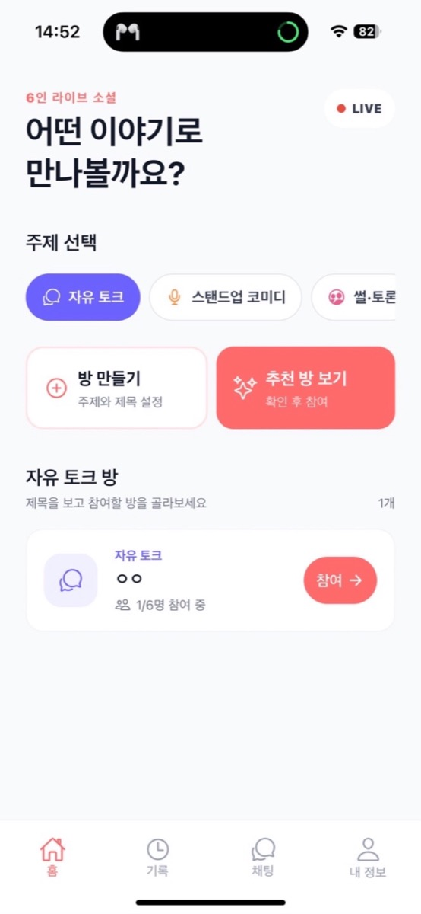
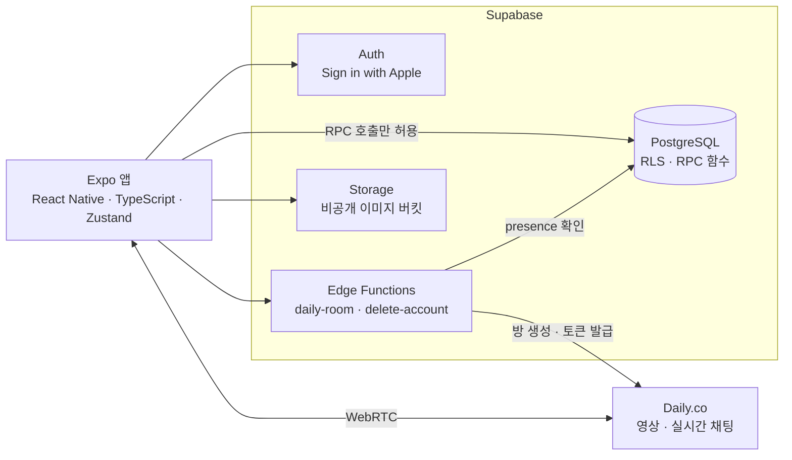

# fuse (퓨즈) — 진행자 중심 라이브 소셜 앱

> 기획부터 설계, 개발, App Store 출시, 광고 집행까지 혼자 맡아 운영 중인 iOS 앱입니다.
> 소스 코드는 비공개 저장소에 있고, 이 저장소는 구조와 기술 결정을 소개합니다.

## 어떤 앱인가

진행자가 주제와 제목을 정해 라이브를 열면, 시청자는 원하는 방을 골라 문자 채팅으로 참여합니다. 영상으로 참여하고 싶으면 요청을 보내고, 진행자가 승인해야 카메라와 마이크가 켜집니다.

- **기간**: 2025.11 ~ 현재 (커밋 110여 개, 1인 개발)
- **출시**: 2026.10 App Store 승인, 이후 업데이트 계속 배포
- **역할**: 기획, UI, 앱·백엔드 개발, 앱 심사 대응, 개인정보·연령 등급 설정, Meta 광고 집행

## 아키텍처

## 기술적으로 고민한 부분

**1. 클라이언트를 믿지 않는 서버 권한 구조**
테이블 직접 쓰기를 막고, 방 입장·퇴장·게스트 승인·메시지 전송을 모두 Postgres RPC 함수로만 처리합니다. 호출자 신원은 함수 안에서 `auth.uid()`로 확인하고, Row Level Security로 다른 사용자의 데이터 접근을 차단합니다.

**2. 동시성 문제**
여러 사용자가 같은 방에 동시에 들어오면 정원을 넘길 수 있습니다. 행 잠금과 advisory lock으로 입장을 직렬화해, 정원 초과와 결제성 작업의 이중 처리를 막았습니다.

**3. "실제로 같이 있었는지"를 서버가 판단**
클라이언트가 보낸 "통화 시작" 기록 대신, Edge Function이 Daily의 presence 정보를 확인해 실제로 같은 방에 있었던 사용자만 참여 기록에 남깁니다. 프로필 열람 권한도 이 기록을 근거로 줍니다.

**4. 유령 방 정리**
앱이 강제 종료되면 방이 영원히 "진행 중"으로 남을 수 있습니다. 20초 heartbeat와 Daily presence 재확인으로, 끊긴 방은 목록에서 바로 숨기고 실제 종료는 서버가 처리합니다.

**5. 사용자 생성 콘텐츠(UGC) 안전장치와 앱 심사 대응**
App Store 심사에서 Guideline 1.2(UGC)와 연령 등급 지적을 받았고, 다음을 구현해 통과했습니다.
- 이용약관(EULA) 동의, 유해 표현 필터(클라이언트와 DB 양쪽)
- 메시지·사용자 신고, 차단 시 양쪽에서 즉시 숨김
- 운영자용 신고 처리 RPC(정지·영구 정지), 신고된 이미지에만 단기 서명 URL 발급
- 만 18세 미만 가입 차단(서버에서 한 번 더 검증)

**6. 계정 삭제와 데이터 보존의 균형**
탈퇴하면 메시지 본문과 이미지는 익명화하거나 삭제하지만, 신고·차단 이력은 안전 대응을 위해 남깁니다.

## 제품 방향 전환

처음에는 2:2, 3:3 그룹 영상 소개팅 앱(랜덤 매칭)으로 시작했습니다. 심사와 안전 문제를 겪으며 랜덤 매칭·익명 모드·개인 채팅을 없애고, **진행자가 책임지는 주제형 라이브** 구조로 바꿨습니다. 데이터베이스 마이그레이션 100여 개에 이 변화가 기록돼 있습니다.

## 품질 관리

- 배포 전 `typecheck`, `lint`, `expo-doctor`, Node 테스트(콘텐츠 필터·인증 저장소·방 생명주기·UGC 안전장치·계정 삭제) 실행
- 운영 DB는 `supabase db lint`로 경고 수준까지 점검
- 실기기 2대로 다중 사용자 흐름(시청, 게스트 승인, 신고, 차단)을 직접 확인한 뒤 제출

## 기술 스택

| 영역 | 사용 기술 |
| --- | --- |
| 앱 | Expo SDK 54, React Native 0.81, React 19, TypeScript, Zustand |
| 백엔드 | Supabase (PostgreSQL, RLS, RPC, Edge Functions, Storage, Auth) |
| 영상·채팅 | Daily.co (WebRTC, app-message) |
| 인증 | Sign in with Apple, Keychain 기반 세션 저장 |
| 배포 | EAS Build, App Store Connect API |
| 마케팅 | Meta SDK, App Tracking Transparency |
